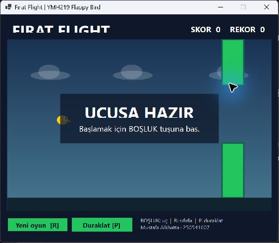

# Fırat Flight — YMH219 Flappy Bird

C# ve Windows Forms ile geliştirilen, yer çekimi ve engellerden kaçış temalı masaüstü oyunu.

**Öğrenci:** Mustafa Alkhatta — **250541607**

## Teknolojiler
- C#, .NET 10, Windows Forms ve System.Drawing.
- Harici NuGet paketi veya görsel dosyası gerektirmez; oyun grafikleri kodla çizilir.

## Kurulum ve çalıştırma
Windows 10/11 ve .NET 10 SDK gereklidir. Visual Studio'da .NET masaüstü geliştirme iş yüküyle `FlappyBird.csproj` açılabilir.

```powershell
git clone https://github.com/MustafaAlkhattab/YMH219-FlappyBird.git
cd YMH219-FlappyBird
dotnet build -c Release
dotnet run -c Release
```

## Temel özellikler
- BOŞLUK ile kanat çırpma, zamana bağlı yer çekimi.
- İki engel çifti, rastgele açıklık konumları ve ekran dışından yeniden dolaşım.
- Engel, tavan ve zemin çarpışması; Game Over ve yeniden başlatma.
- Geçilen engel başına bir puan ve puanla artan hız.
- R: yeni oyun; P: duraklat/devam. Pencere odağı kaybolduğunda otomatik duraklatma.
- Rekor `%LOCALAPPDATA%/YMH219-FlappyBird/best.txt` dosyasında tutulur.

## Nesne tabanlı tasarım
`Bird` hız/konum ve zıplamayı, `Pipe` engel geometrisini, `Game` çarpışma, skor ve durum geçişlerini yönetir. `Form1` sadece giriş, çizim ve zamanlayıcı bağlantısını kurar. `GameCanvas` çift tamponlama ile titremeyi azaltır.

## Ekran görüntüleri
Çalışan uygulamadan alınmıştır.




## Kontrol ve sınırlamalar
- Windows üzerinde Release derlemesi: 0 hata, 0 uyarı.
- Klavyeyle uçuş, zemin çarpışması ve R ile sıfırlama çalıştırılarak kontrol edildi.
- Sabit oyun alanı kullanılır; ses efekti yoktur. Rekor dosyasına erişilemiyorsa oyun devam eder, rekor o oturumda bellekte tutulur.
- Ayrı bir bilgisayarda çalıştırma henüz doğrulanmadı.

## Kısa sözlü hazırlık
- Timer ekrana düzenli aralıklarla güncelleme gönderir; hareket geçen saniye ile çarpılır.
- Dikdörtgen kesişmesi çarpışmayı belirler; `Passed` aynı engelden tekrar puan alınmasını önler.
- `GameStatus` hazır/çalışıyor/duraklatıldı/bitti durumlarını ayırır.
