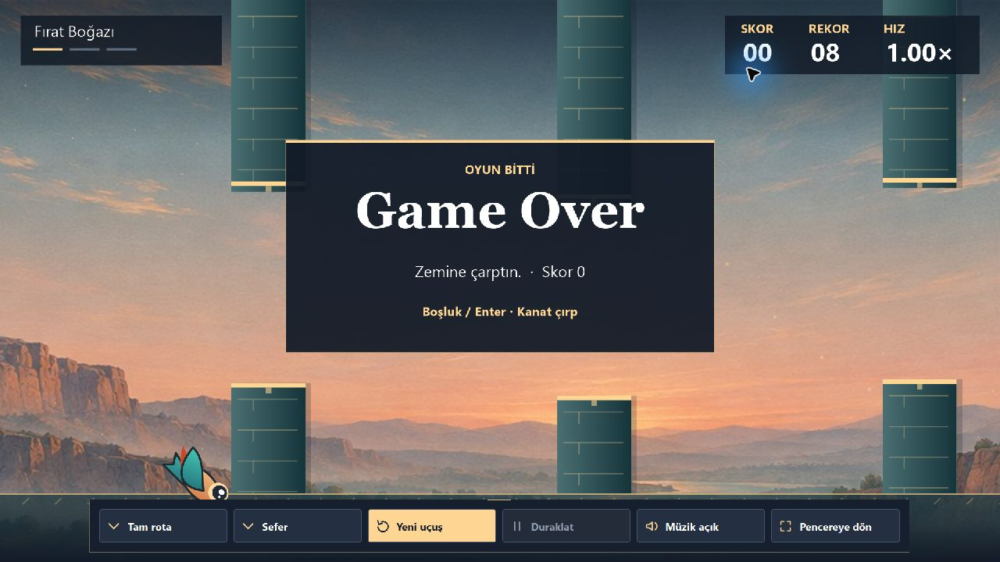
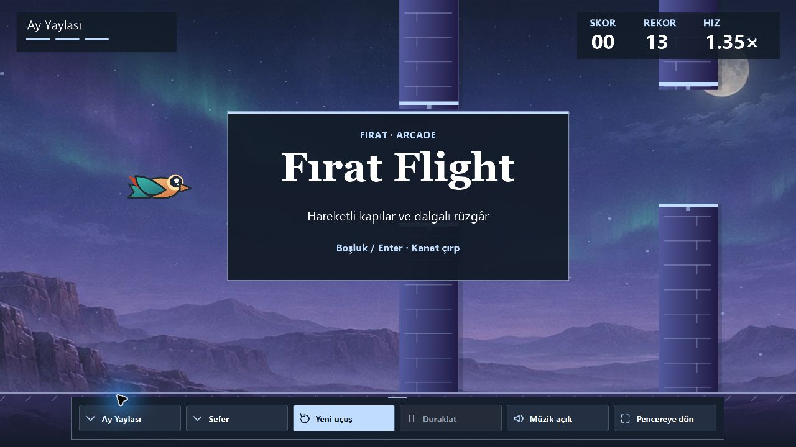

# Fırat Flight

YMH219 için C# ve Windows Forms ile yazılmış, Fırat vadisinden gece yaylasına uzanan bir arcade uçuş oyunu.

**Öğrenci** · Mustafa Alkhatta, 250541607

## Açılış

Windows 10/11 ve .NET 10 SDK gereklidir. Visual Studio'da .NET masaüstü geliştirme iş yükü ile `FlappyBird.csproj` açılıp F5'e basılabilir.

```powershell
git clone https://github.com/MustafaAlkhattab/YMH219-FlappyBird.git
cd YMH219-FlappyBird
dotnet run -c Release
```

## Nasıl oynanır?

- **Boşluk, Enter, ↑** veya uçuş alanına tıklama kanat çırpar. Yer çekimi kuşu aşağı çeker.
- **R / Yeni uçuş** skoru sıfırlar. **P / Duraklat** oyunu duraklatıp sürdürür. Odak kaybında oyun durur.
- Sahne pencereyi kenardan kenara kaplar. **F11 / Tam ekran** ile başlık çubuğu olmadan tüm ekranda oynayın; F11 ile pencereye dönün.
- Bölge, zorluk, yeni uçuş, duraklatma, müzik ve ekran kontrolleri sahneye yerleştirilen tek paneldedir.
- Uçuş sırasında **Flowerbed Fields [Loop]** tüm bölgelerde döngüde çalar. **M / Müzik** ile açıp kapatın. Uçuş durduğunda müzik duraklar.
- **Tam rota** Fırat Boğazı'nda başlar. Beş kapıda Kızıl Geçit, on kapıda Ay Yaylası açılır. Ayrı bir bölge seçerek orada doğrudan antrenman yapabilirsiniz.
- Her geçiş bir puandır. Hız puanla artar. Kızıl Geçit'te aralıklar daralır, Ay Yaylası'nda geçitler hareket eder ve rüzgâr dalgalanır. **Ustalık** daha hızlı ve daha dar bir rota sunar.
- Zemin, tavan ve kapılar uçuşu bitirir. Oyun bitince Boşluk veya Enter yeni deneme başlatır. Her rota ve zorluk için ayrı rekor saklanır.

## Teknoloji ve tasarım

C# / .NET 10, Windows Forms, GDI+ (System.Drawing), System.Text.Json, NAudio.WinMM ve NAudio.Vorbis. `Game` sabit zaman adımlarıyla yer çekimi, hareket, çarpışma ve puanlamayı yönetir. `Bird` ve `Gate` ölçüleri ile hareketlerini taşır. `FlightCanvas` genişliğe göre sahneyi çizer. `FlightDeck` kontrolleri yeterli alan yoksa ikinci sıraya alır. `FlightMusic` yerel OGG dosyasını çalar. `HighScores` rekorları yerel olarak saklar.

## Ekran görüntüleri





## Doğrulama ve sınırlamalar

Windows Release derlemesi, tam ekran, Enter ile uçuş, çarpışma ve bölge seçimi denenmiştir. Sabit tohumlu bir model denemesinde üç bölge ve yeniden doğan kapılar geçildi. Müzik dosyasının döngü sınırı ve Windows üzerinde çalma, kısma ve duraklatma kontrol edildi. Rekorlar `%LOCALAPPDATA%\YMH219-FlappyBird\scores.json` dosyasına yazılır. Önceki `best.txt` rekoru Tam rota / Sefer için devralınır.

[Arka plan görseli kaynak ve istemi](art/README.md)

[Müzik kaynağı ve CC0 lisansı](audio/CREDITS.md)
